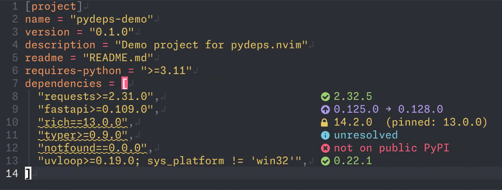
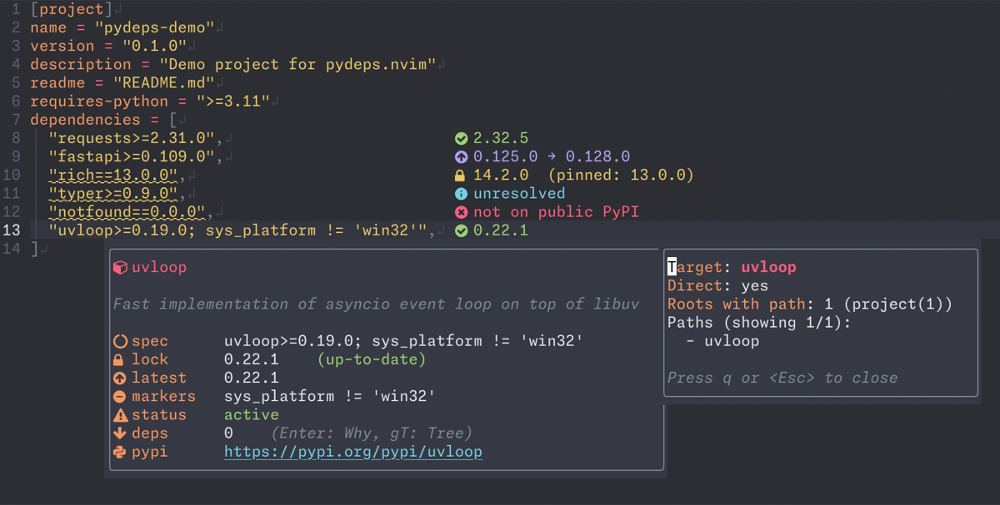
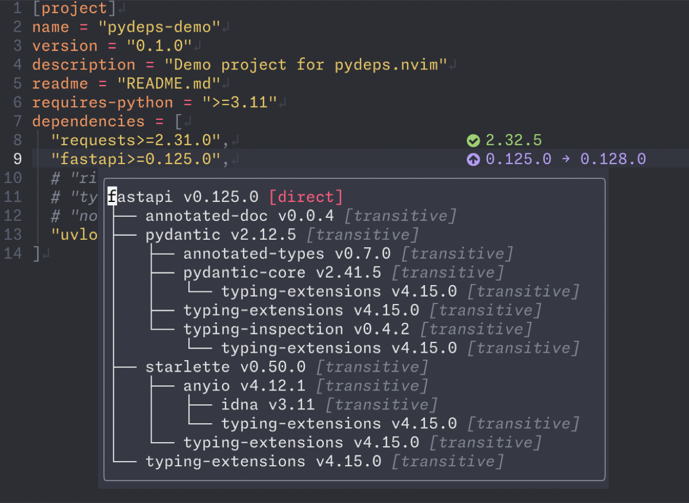
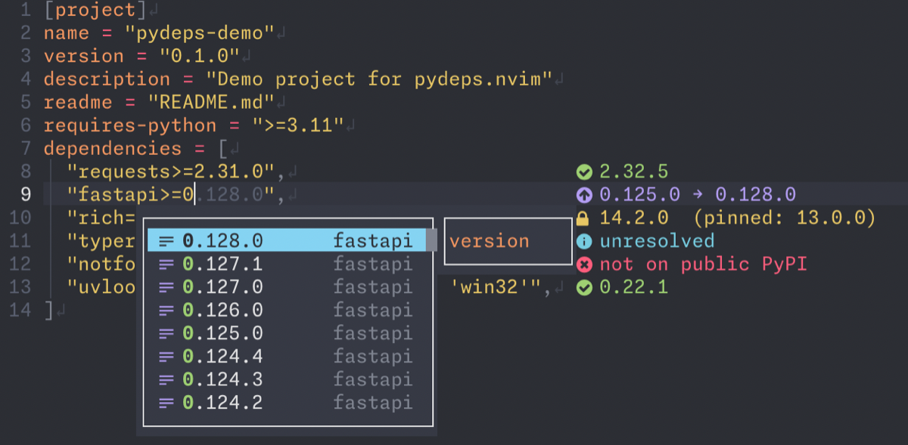

# pydeps.nvim

[](https://github.com/mhiro2/pydeps.nvim/releases/latest)
[](https://github.com/mhiro2/pydeps.nvim/actions/workflows/ci.yaml)

Lockfile-first dependency explorer for Python — focused on **resolved versions**, **real environments**, and **uv-powered workflows**.

pydeps.nvim treats **lockfiles as first-class citizens** and integrates directly with modern Python tooling such as `uv`.

## 🎬 Demo

### Inline Badges



### `:PyDepsInfo`



### `:PyDepsTree`



### Completion



## 💡 Why pydeps.nvim?

Most Python dependency plugins answer:
> "What is the latest version?"

pydeps.nvim answers:
> "What version will actually be installed, and why?"

Key differences:
- **Lockfile-first**: Shows locked versions selected by known environment markers
- **Environment-aware**: PEP 508 marker evaluation with PEP 440 version comparisons (Python version, platform, extras, groups)
- **Modern tooling**: Deep integration with `uv` instead of generic pip/requirements
- **Editor-native workflow**: Review lockfile changes before committing

pydeps.nvim brings the **crates.nvim workflow to Python** with a focus on what will actually run in your environment.

## ✨ Features

### Core

- 🔒 **Lockfile-first view**: show **resolved** versions from `uv.lock`
- 🧭 **Why-installed tracing**: understand **dependency provenance**
- 🧪 **PEP 508 aware**: markers for Python version, platform, extras, and groups
- 🎛️ **Shared environment context**: pick the Python, platform, extras, and groups that badges, Info, Why, and Tree all evaluate
- 🧩 **Inline badges**: section-aligned, comment-aware UI with icons & highlights
- ⚡ **Review-first resolve**: `uv lock` + lockfile diff before committing
- 🧰 **Mismatch detection**: pin vs resolved version + yanked checks on PyPI
- 🔐 **Security audit**: lockfile-wide vulnerability scan via OSV

Marker comparisons preserve case, and `in`/`not in` are substring membership on every
field. Ordering comparisons on version fields support PEP 440 ordering, compatible
releases (`~=`), wildcards, and arbitrary equality (`===`). Invalid markers and unknown
fields are reported and drop the dependency to an unknown state; while the environment
is still being read the marker stays pending and the locked version is still shown.
`group` and `dependency_group` are pydeps extensions. Lock marker sets (`extras`,
`dependency_groups`) are only known once `:PyDepsContext` selects extras or groups.

Universal lockfiles retain every name/version/source identity. Inline versions are
projected using the environment context (the detected Python environment unless
`:PyDepsContext` overrides it); ambiguous forks remain unresolved
until their markers can select one identity. This is a lockfile view, not a report
of packages already installed. Audits cover all locked versions regardless of the
current environment. Conditional dependency edges retain versions, sources, markers,
extras, and development groups; optional paths require their extra/group selection.

### Optional

- 🌳 **Dependency tree**: inspect with `uv tree`
- 📡 **PyPI info & diagnostics**: metadata-backed details in editor
- ⌨️ **Smart completion**: packages / versions / extras / groups (nvim-cmp, blink.cmp)

## 📁 Supported Files

- `pyproject.toml`
- `uv.lock`

## 📦 Requirements

- Neovim ≥ 0.12
- `uv`
- Tree-sitter `toml` parser available on `runtimepath` (required for accurate inline badge alignment and comment-aware positioning)

## 🚀 Installation

```lua
{
  "mhiro2/pydeps.nvim",
  config = function()
    require("pydeps").setup()
  end,
}
```

`pydeps.nvim` does not require `nvim-treesitter`, but it does require a Tree-sitter TOML parser that Neovim 0.12 can discover as `parser/toml.*` on `runtimepath`.

## ⚙️ Configuration

pydeps.nvim is configurable via `require("pydeps").setup({ ... })`.

<details><summary>Default Settings</summary>

```lua
{
  show_virtual_text = true,
  show_missing_virtual_text = true,
  show_missing_lockfile_virtual_text = true,
  missing_lockfile_virtual_text = "missing uv.lock",
  ui = {
    enabled = true,
    section_padding = 4,
    icons = {
      enabled = true,
      searching = "",
      loading = "",
      update = "",
      ok = "",
      inactive = "󰍶",
      yanked = "󰀪",
      lock_mismatch = "",
      pin_not_found = "",
      unknown = "󰋼",
      package = "",
      spec = "",
      lock = "",
      latest = "",
      extras = "",
      markers = "󰍶",
      context = "",
      status = "",
      deps = "",
      pypi = "󰌠",
      fallback = {
        searching = "?",
        loading = "~",
        update = "^",
        ok = "=",
        inactive = "-",
        yanked = "!",
        lock_mismatch = "!",
        pin_not_found = "x",
        unknown = "?",
      },
    },
    show = {
      resolved = true,
      latest = true,
    },
    status_text = {
      searching = "Searching",
      loading = "Loading",
    },
  },
  auto_refresh = true,
  refresh_debounce_ms = 200,
  info_window_border = "rounded",
  select_menu_border = "rounded",
  select_menu_relative = "cursor",
  audit_window_border = "rounded",
  notify_on_missing_lockfile = true,
  enable_diagnostics = true,
  diagnostic_severity = {
    yanked = vim.diagnostic.severity.WARN,
    marker = vim.diagnostic.severity.WARN,
    lock = vim.diagnostic.severity.WARN,
  },
  pypi_url = "https://pypi.org/pypi",
  pypi_cache_ttl = 3600,
  osv_url = "https://api.osv.dev/v1/querybatch",
  osv_cache_ttl = 3600,
  enable_completion = true,
  completion = {
    pypi_search = true,
    pypi_search_min = 2,
    max_results = 30,
  },
}
```

</details>

## 🎨 Customizing Highlights

pydeps.nvim uses treesitter-based highlight groups for a modern, theme-consistent appearance. You can customize any highlight group using `:highlight` after setup:

```lua
-- Customize info window highlights
vim.api.nvim_set_hl(0, "PyDepsInfoUrl", { link = "@markup.link.url" })
vim.api.nvim_set_hl(0, "PyDepsInfoPackage", { link = "Title", bold = true })

-- Customize virtual text badges
vim.api.nvim_set_hl(0, "PyDepsOk", { link = "DiagnosticOk" })
vim.api.nvim_set_hl(0, "PyDepsUpdate", { link = "DiagnosticWarn" })

-- Customize tree badges
vim.api.nvim_set_hl(0, "PyDepsBadgeDirect", { link = "@keyword" })
vim.api.nvim_set_hl(0, "PyDepsBadgeExtra", { link = "@constant" })
```

**Available highlight groups:**

- **Info Window**: `PyDepsInfoPackage`, `PyDepsInfoDescription`, `PyDepsInfoLabel`, `PyDepsInfoValue`, `PyDepsInfoUrl`, `PyDepsInfoVersion`, `PyDepsInfoPill`, `PyDepsInfoStatus*`, `PyDepsInfoSuffix*`
- **Virtual Text**: `PyDepsOk`, `PyDepsUpdate`, `PyDepsMajor`, `PyDepsYanked`, `PyDepsInactive`, `PyDepsLockMismatch`, `PyDepsPinNotFound`, `PyDepsUnknown`, `PyDepsResolved`, `PyDepsMissing`, `PyDepsLabel`, `PyDepsSearching`, `PyDepsLoading`
- **Tree Badges**: `PyDepsBadgeDirect`, `PyDepsBadgeTransitive`, `PyDepsBadgeGroup`, `PyDepsBadgeExtra`

See `:help pydeps-highlights` for the complete list and default links.

## ⌨️ Completion

pydeps completes PEP 508-style dependency strings in `pyproject.toml`.
It works with both **nvim-cmp** and **blink.cmp**.
Completion only runs inside `[project] dependencies`, `[project.optional-dependencies]`
and `[dependency-groups]` arrays; other strings and comments are left alone.

**What you can complete:**
- **Package names**: PyPI search suggestions (min 2 chars)
- **Versions**: type a constraint (`==`, `>=`, `~=`, etc.) → release versions
- **Extras**: type `[` inside a package spec → available extras
- **Markers**: type `;` (or `and` / `or` / `(`) → marker fields (`python_version`, `sys_platform`, `platform_system`, `extra`, `group`, etc.)
- **Marker values**: type a comparison after a field → common values (`sys_platform`, `platform_system`, `os_name`, `platform_machine`, `implementation_name`, `platform_python_implementation`), the current environment's value, and the project's own extras/groups for `extra`/`group`. Values are quoted for you when no quote has been typed yet.

**Examples:**
- `requests[security]>=2.31; python_version >= "3.11"`
- `fastapi ~= 0.110`

> [!NOTE]
> Package-name suggestions are **best-effort**. PyPI provides no official
> package-search API, so pydeps scrapes the public `/search/` page. That markup
> is unofficial and may change or be rate-limited at any time; when it fails,
> completion degrades to locally known names (lockfile, environment, and names
> already in the file) and warns once per session. Set
> `completion.pypi_search = false` to disable the network search entirely.

### nvim-cmp

```lua
require("cmp").setup({
  sources = {
    { name = "pydeps" },
    -- other sources...
  },
})
```

### blink.cmp

```lua
require("blink.cmp").setup({
  sources = {
    default = { "pydeps" },
    providers = {
      pydeps = {
        name = "pydeps",
        module = "pydeps.completion.blink",
      },
    },
  },
})
```

## 💻 Commands

- `:PyDepsToggle` — toggle inline badges and diagnostics
- `:PyDepsUpdate [package]` — plan an update for the dependency under cursor (or named package) and apply the candidate you pick
  - Runs `uv lock --dry-run --upgrade-package` alongside a PyPI lookup, then lists in one menu:
    - the version uv resolves while keeping the declaration, with the lock changes it plans
    - the newest release inside the declared range when uv resolves an older one (locked with `--upgrade-package name==version`)
    - the newest release outside the range for the project's `requires-python`, with the rewritten declaration
  - Picking a candidate runs `uv lock` and shows the lockfile diff; a declaration change is saved first and restored if uv cannot lock it
  - Notes explain releases left out, such as a latest version requiring a newer Python or a failed dry run
  - `pyproject.toml` must be saved first, and the update is cancelled if the buffer changes before a candidate is picked
  - The package name prompt applies to the buffer that asked, not the current one
- `:PyDepsResolve` — resolve dependencies via `uv` and show lockfile diff
  - `:PyDepsResolve!` shows diff only (no lock)
- `:PyDepsWhy [package]` — show transitive provenance for dependency
  - Only declared dependencies active in the current context are followed as roots
- `:PyDepsContext [field] [value...]` — show or change the environment context shared by badges, diagnostics, Info, Why, and Tree
  - Without arguments, opens a menu listing each field and whether it is detected or overridden
  - `python 3.11` evaluates markers for that Python; like uv, a version without a patch is read as its first patch release (`3.11.0`)
  - `platform linux` evaluates markers for a uv `--python-platform` target (`linux`, `macos`, `windows`, or a triple such as `aarch64-unknown-linux-gnu`)
  - `extras postgres` / `groups dev,test` select extras and dependency groups; `all` stops filtering and `none` selects nothing. Groups include their `include-group` members
  - `reset [field]` drops every override or one field
  - Dependencies outside the selection, or whose marker is false, are shown as inactive; Info explains why, e.g. `sys_platform == "win32" is false (sys_platform is "darwin")`
  - The context is a view of the lock's selection, not a check that wheels exist for the target platform
- `:PyDepsInfo` — inspect dependency under cursor
- `:PyDepsAudit` — audit every distinct locked name/version against OSV, including all universal resolution forks
  - Failed and unscanned packages are listed separately, never counted as clean scans
  - A failed request retains its error during the 60-second retry backoff
  - CVSS vectors are preserved in the report; without a numeric score or a recognized database severity, their severity is UNKNOWN. GitHub's MODERATE level ranks with MEDIUM
- `:PyDepsTree` — show dependency tree (uses `--frozen` by default)
  - `:PyDepsTree --resolve` skips frozen mode and attempts dependency resolution; this may update `uv.lock`, which is reported and refreshes open buffers
  - If the installed `uv` does not support `--frozen`, a warning is shown and the tree runs without it
  - The context is passed to `uv tree`: Python and platform overrides as `--python-version` / `--python-platform` (skipped with `--universal`), and groups as `--all-groups` while unfiltered or `--no-default-groups --group ...` once selected. Explicit group options replace the context's groups, and `uv tree` has no extras filter

Run `:checkhealth pydeps` to verify your setup.

## 📚 Documentation

See `:help pydeps` for complete documentation.

## 🔀 Alternatives

If you primarily manage dependencies via `requirements.txt`-style workflows, [py-requirements.nvim](https://github.com/MeanderingProgrammer/py-requirements.nvim/tree/main) is a solid choice.
pydeps.nvim is optimized for **lockfiles** and **`uv`-based** environments, so the best fit depends on how your project is managed.

Quick differences:
- **pydeps.nvim**: lockfile-first, resolved dependency view, `uv.lock` integration
- **py-requirements.nvim**: requirements-first, declared dependency view

## 📄 License

MIT License. See [LICENSE](./LICENSE).
